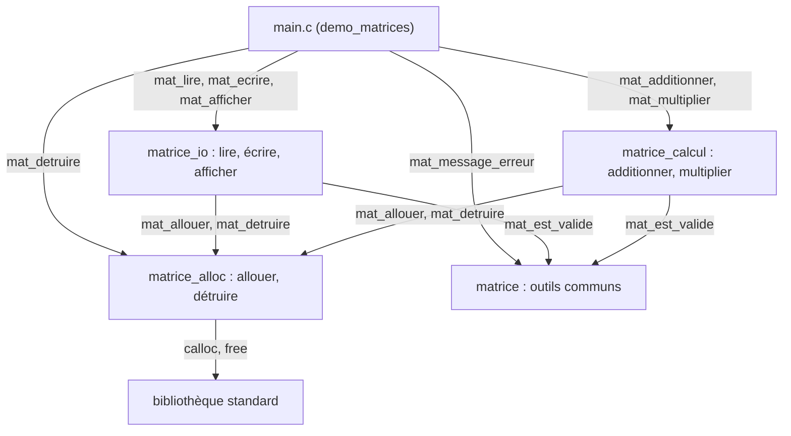
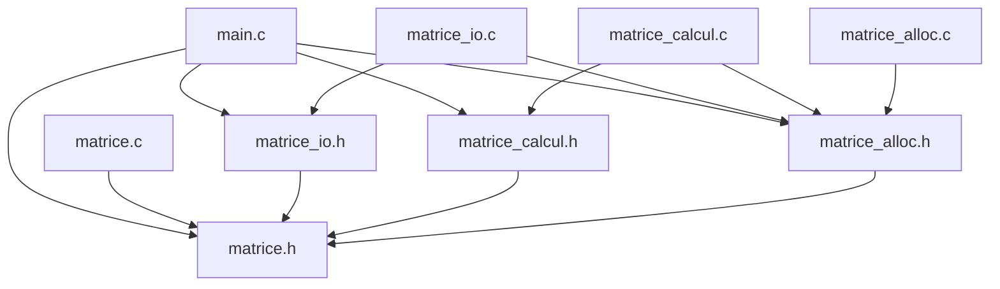

# TD Matrices — Stockage de matrices en C

- **TD** : Stockage de matrices en C — Programmation C, 3e année STI, INSA Centre Val de Loire
- **Groupe de TD** : TD1 
- **Date de remise** : 2 novembre 2026
- **Membres** :
  - Ben Makhlouf Ahmed: ahmed21235
  - GHABRI Fahd — GitHub : fahdghabri2022-max

## Table des matières

- [2. Introduction](#2-introduction)
- [3. Conception](#3-conception)
- [4. Réalisation, exercice par exercice](#4-réalisation-exercice-par-exercice)
- [5. Vérifications mémoire](#5-vérifications-mémoire)
- [6. Démonstration finale](#6-démonstration-finale)
- [7. Bilan et difficultés](#7-bilan-et-difficultés)
- [Annexes](#annexes)

## 2. Introduction

**Le problème.** Ce TD construit une petite bibliothèque C qui crée, enregistre, relit, affiche et combine (somme et produit) des matrices d'entiers dont la taille n'est connue qu'à l'exécution. Le code est découpé en quatre modules : `matrice` (le type `Matrice`, les codes d'erreur et deux outils communs), `matrice_alloc` (création et destruction), `matrice_io` (fichiers texte et affichage) et `matrice_calcul` (addition et multiplication). Le programme `demo_matrices` (`main.c`) lit deux matrices dans des fichiers, calcule leur somme ou leur produit, puis affiche et enregistre le résultat. Les objectifs : séparer l'interface (`.h`) de l'implémentation (`.c`), pratiquer la compilation séparée, allouer une structure à deux niveaux en gérant l'échec partiel, respecter des règles de propriété de la mémoire, vérifier chaque opération sur les fichiers et traiter toutes les erreurs de la même façon, par des codes de retour.

**Ce qui fonctionne à la remise.** Les quatre exercices sont complets.

| Vérification | Résultat |
|---|---|
| `test_ex1`, `test_ex2`, `test_ex3` | 16/16, 14/14, 14/14 |
| Avertissements avec `-std=c11 -Wall -Wextra -Wpedantic` | 0 |
| valgrind sur les trois tests et sur `demo_matrices` (succès et erreurs) | aucune fuite, aucune erreur |
| Scénarios du sujet (partie 6) | 10 sur 10 conformes |
| `make` depuis un dossier vide | produit les quatre programmes |

Deux limites sont connues : la lecture ne vérifie pas la disposition des coefficients en lignes, et elle ignore ce qui suit le dernier coefficient (Q4.2). Elles découlent du format défini par le sujet. L'exercice 4 a été terminé en dernier, avec une aide d'IA déclarée en partie 7.

## 3. Conception

### Schéma des modules

Une flèche signifie « appelle » ; l'étiquette donne les fonctions appelées.



Le graphe n'a pas de cycle, et chaque module n'appelle que ce dont il a besoin : `matrice_calcul` ne touche à aucun fichier, `matrice_alloc` ne dépend que de la bibliothèque standard et `matrice` n'appelle aucun autre module. Seul `main.c` utilise les quatre. La vérification automatique le confirme : `test_ex3` est lié sans `matrice_io.c`, ce qui échouerait si `matrice_calcul.c` appelait `matrice_io`. Les tests utilisent les modules comme `main.c` : `test_ex1` appelle `matrice` et `matrice_alloc`, `test_ex2` y ajoute `matrice_io`, `test_ex3` y ajoute `matrice_calcul`.

### Graphe des inclusions

Une flèche X → Y signifie « X contient `#include "Y"` ».



Chaque `.c` inclut d'abord son propre `.h`, pour que le compilateur vérifie que les définitions correspondent aux prototypes. Tous les en-têtes passent par `matrice.h`, qui définit `Matrice` et `MatErreur` ; `matrice_io.h` inclut aussi `<stdio.h>`, car ses prototypes utilisent `FILE`. Les `.c` ajoutent les en-têtes standard qu'ils utilisent : `<stdlib.h>` pour `calloc` et `free`, `<limits.h>` pour `INT_MAX` et `LLONG_MAX`, `<errno.h>` et `<string.h>` pour les messages de `main.c`. Les tests incluent `matrice.h` et `matrice_alloc.h`, plus `matrice_io.h` (`test_ex2`) ou `matrice_calcul.h` (`test_ex3`).

**Pourquoi le garde `#ifndef`.** `main.c` reçoit `matrice.h` quatre fois : directement, puis par les trois autres en-têtes. Au premier passage, `MATRICE_H` est défini ; aux suivants, `#ifndef MATRICE_H` est faux et le préprocesseur saute le fichier. Sans garde, le type serait défini plusieurs fois dans la même unité de compilation. Expérience : sur une copie de `matrice.h` privée des trois lignes du garde, un fichier qui inclut `matrice.h` puis `matrice_alloc.h` ne compile plus.

```text
sansgarde/matrice.h:15:16: error: redefinition of 'struct matrice'
sansgarde/matrice.h:20:3: error: conflicting types for 'Matrice'; have 'struct matrice'
sansgarde/matrice.h:28:5: error: redeclaration of enumerator 'MAT_OK'
```

### Règles de propriété de la mémoire

| Règle | Principe | Où notre code la respecte |
|---|---|---|
| R1 | toute `Matrice` démarre à `MATRICE_VIDE` | `a`, `b`, `r` dans `main` ; `r` dans les deux calculs |
| R2 | `MAT_OK` : l'appelant devient propriétaire du résultat | `res->coef = coef;` (1.e), `*res = tmp;` (2.f), `*res = r;` (3.d, 3.h) |
| R3 | en cas d'échec, `*res` est vide et il n'y a rien à libérer | `*res = MATRICE_VIDE` en tête de `mat_allouer`, `mat_lire` et des calculs ; destruction de la matrice locale avant chaque `return` d'erreur |
| R4 | une entrée `const Matrice *` n'est ni modifiée ni libérée | `mat_ecrire`, `mat_afficher`, `mat_additionner`, `mat_multiplier` |
| R5 | `*res` est écrasé ; `res` doit être distinct des entrées | refus de `res == a` ou `res == b` dans `verifier_parametres` (Q5.2) |
| R6 | `mat_detruire` remet la matrice à vide | `*m = MATRICE_VIDE;` en fin de `mat_detruire` (Q3.3) |
| R7 | un fichier est fermé par le code qui l'a ouvert | `fopen` et `fclose` dans `charger` et `sauvegarder` ; aucun `fclose` dans `matrice_io.c` |

Une seule fonction alloue la mémoire des matrices, `mat_allouer` ; `mat_lire` et les deux calculs l'appellent sur une matrice locale, qu'ils ne transmettent qu'en cas de succès. Une fonction qui reçoit une matrice en entrée l'utilise sans la posséder. Le propriétaire final est le code qui a reçu `MAT_OK` : dans `demo_matrices`, c'est `main`, qui détruit ses trois matrices en un seul point de sortie. Après un échec, la sortie vaut `MATRICE_VIDE` : rien à libérer, mais `mat_detruire` reste sans danger.

### Justification des choix

**Ce qui est `static`.** Les fonctions internes, absentes des `.h` : `lire_entier`, `verifier_parametres`, `tient_dans_int`, `charger`, `sauvegarder`, et `mat_calloc` quand on compile avec `-DMAT_TEST_ALLOC` (sinon, c'est une simple macro vers `calloc`). `static` les rend invisibles hors de leur fichier : on peut les modifier sans risque pour les autres modules, et deux modules pourraient avoir une fonction interne du même nom sans conflit. `nm matrice_io.o` affiche `t lire_entier` (symbole local) à côté de `T mat_lire` (symbole exporté). Expérience : un fichier qui déclare puis appelle `lire_entier` compile, mais l'édition de liens échoue.

```text
statique.c:7:(.text+0x2d): undefined reference to `lire_entier'
collect2: error: ld returned 1 exit status
```

**Échec partiel.** Si la ligne `i` échoue, `mat_allouer` rend les lignes `i - 1` à `0`, puis le tableau, et ne remplit `*res` qu'après la boucle (1.e) : l'appelant ne reçoit jamais une matrice à moitié construite. Le même principe s'applique au-dessus : `mat_lire` remplit `tmp`, les calculs remplissent `r`, et chaque `return` d'erreur détruit d'abord cette matrice locale. Les tests simulent un échec à chaque allocation possible (`-DMAT_TEST_ALLOC`) : (1.d), (2.d) et (3.f) sont `[OK]`, sans fuite.

**Dépassement d'entier.** Un dépassement d'`int` est un comportement indéfini (Q5.4) : il faut le détecter avant. La somme de deux `int` est calculée en `long long`, où elle tient toujours, puis `tient_dans_int` la compare à `INT_MIN` et `INT_MAX`. Pour le produit, chaque terme tient aussi en `long long` (au plus 2<sup>62</sup> en valeur absolue), mais la somme de p termes peut dépasser `LLONG_MAX` : avant chaque `s += p`, on vérifie `s > LLONG_MAX - p` ou `s < LLONG_MIN - p`, puis on contrôle le coefficient final. Une somme intermédiaire peut sortir des `int` sans erreur : le calcul en `long long` reste exact, et seul le résultat final doit tenir dans un `int`.

**Erreurs.** La bibliothèque renvoie un `MatErreur` et n'affiche aucun message d'erreur ; seul `main.c` écrit les messages, sur `stderr` (Q6.1). `main` initialise `statut` à `EXIT_FAILURE` et saute à `nettoyage` à la première erreur.

### Compilation

Le `Makefile` compile chaque `.c` séparément (`gcc -c`), puis assemble les objets. Les tests utilisent des objets compilés avec `-DMAT_TEST_ALLOC` (suffixe `_t.o`), comme dans les commandes du sujet ; `demo_matrices` utilise les objets normaux. Les dépendances vers les `.h` recopient le graphe des inclusions : modifier `matrice_alloc.h` recompile tout ce qui l'inclut, et seulement cela. `make` depuis un dossier vide produit les quatre programmes sans avertissement ; `make clean` efface les fichiers produits.

```makefile
# Makefile du TD « Stockage de matrices en C »
#
#   make         compile les quatre programmes (cible par défaut : all)
#   make clean   supprime les fichiers produits par la compilation
#
# Compilation séparée : chaque .c donne un fichier objet (.o), puis
# l'édition de liens assemble les objets en un exécutable.
# Les programmes de test utilisent des objets compilés avec -DMAT_TEST_ALLOC
# (suffixe _t.o), qui active la simulation d'échec d'allocation ;
# demo_matrices utilise les objets normaux (.o), sans cette option.

CC     = gcc
CFLAGS = -std=c11 -Wall -Wextra -Wpedantic -g

PROGRAMMES = test_ex1 test_ex2 test_ex3 demo_matrices

all: $(PROGRAMMES)

# ---- Édition de liens ------------------------------------------------
demo_matrices: main.o matrice.o matrice_alloc.o matrice_io.o matrice_calcul.o
	$(CC) $(CFLAGS) $^ -o $@

test_ex1: test_ex1_t.o matrice_t.o matrice_alloc_t.o
	$(CC) $(CFLAGS) $^ -o $@

test_ex2: test_ex2_t.o matrice_t.o matrice_alloc_t.o matrice_io_t.o
	$(CC) $(CFLAGS) $^ -o $@

test_ex3: test_ex3_t.o matrice_t.o matrice_alloc_t.o matrice_calcul_t.o
	$(CC) $(CFLAGS) $^ -o $@

# ---- Compilation (règles génériques) ---------------------------------
%.o: %.c
	$(CC) $(CFLAGS) -c $< -o $@

%_t.o: %.c
	$(CC) $(CFLAGS) -DMAT_TEST_ALLOC -c $< -o $@

# ---- Dépendances vers les en-têtes (recopient le graphe des inclusions)
matrice.o matrice_t.o:               matrice.h
matrice_alloc.o matrice_alloc_t.o:   matrice_alloc.h matrice.h
matrice_io.o matrice_io_t.o:         matrice_io.h matrice_alloc.h matrice.h
matrice_calcul.o matrice_calcul_t.o: matrice_calcul.h matrice_alloc.h matrice.h
main.o:     matrice.h matrice_alloc.h matrice_io.h matrice_calcul.h
test_ex1_t.o: matrice.h matrice_alloc.h
test_ex2_t.o: matrice.h matrice_alloc.h matrice_io.h
test_ex3_t.o: matrice.h matrice_alloc.h matrice_calcul.h

clean:
	rm -f *.o $(PROGRAMMES) test_ex2_sortie.txt R.txt R2.txt

.PHONY: all clean
```

## 4. Réalisation, exercice par exercice

Seul le code écrit aux emplacements « À COMPLÉTER » est reproduit.

### Exercice 1 — matrice.c, matrice_alloc.c

#### Code écrit

**Étape 1.a** — Les deux messages manquants, sur le modèle du `switch`. Ce sont des chaînes littérales : rien à allouer ni à libérer.

```c
    case MAT_ERR_DIMENSIONS:  return "dimensions incompatibles";
    case MAT_ERR_DEPASSEMENT: return "dépassement de capacité";
```

**Étape 1.b** — Une seule expression. L'ordre compte : `&&` s'arrête au premier terme faux, donc `m->coef` n'est lu qu'une fois `m != NULL` vérifié.

```c
    return m!= NULL
        && m->coef != NULL
        && m->nb_lignes >= 1 && m->nb_lignes <= MAT_DIM_MAX
        && m->nb_colonnes >= 1 && m->nb_colonnes <= MAT_DIM_MAX;
```

**Étape 1.c** — Refus des dimensions hors de [1, `MAT_DIM_MAX`] ; `*res` a déjà été mis à vide par le code fourni (Q3.4).

```c
    if (nb_lignes <1 || nb_lignes>MAT_DIM_MAX || nb_colonnes < 1 || nb_colonnes > MAT_DIM_MAX)
        return MAT_ERR_ARGUMENT;
```

**Étape 1.d** — Une allocation par ligne (`sizeof *coef[i]` vaut `sizeof(int)`). Si la ligne `i` échoue, on rend les lignes `i - 1` à `0`, puis `coef` : dans l'autre ordre, on lirait les adresses des lignes dans une zone déjà libérée.

```c
    for (int i = 0; i < nb_lignes; i++) {
        coef[i] = mat_calloc((size_t)nb_colonnes, sizeof *coef[i]);    // nb_colonnes entiers
        if (coef[i] == NULL) {
            for (int k = i - 1; k >= 0; k--)  // lignes déjà
               free(coef[k]);                // obtenues
            free(coef);                       // puis le tableau
            return MAT_ERR_ALLOCATION;
        }
    }
```

**Étape 1.e** — `*res` n'est rempli qu'une fois tout réussi : c'est le transfert de propriété (R2).

```c
    res->coef = coef;
    res->nb_lignes = nb_lignes;
    res->nb_colonnes = nb_colonnes;
    return MAT_OK;
```

**Étape 1.f** — Les lignes, puis le tableau. La fonction est sans effet sur une matrice vide, et la ligne fournie qui suit, `*m = MATRICE_VIDE;`, rend un second appel inoffensif (R6).

```c
    if (m->coef != NULL) {
        for (int i = 0; i < m->nb_lignes; i++) {
            free(m->coef[i]);
        }
        free(m->coef);
    }
```

#### Questions

**Q3.1** — `mat_detruire` doit libérer la mémoire et remettre la variable de l'appelant à `MATRICE_VIDE` (R6). Par valeur, elle recevrait une copie : elle pourrait encore libérer, puisque la copie contient la même adresse `coef`, mais la remise à vide ne toucherait que la copie. La variable de l'appelant garderait un `coef` devenu invalide et ses anciennes dimensions : impossible de savoir qu'elle a été détruite, et un second appel libérerait deux fois la même mémoire. Avec `Matrice *m`, la ligne `*m = MATRICE_VIDE;` modifie bien la variable de l'appelant.

Expérience : une version par valeur, identique à notre `mat_detruire` sauf pour le paramètre, appelée deux fois.

```c
static void detruire_par_valeur(Matrice m)
{
    if (m.coef != NULL) {
        for (int i = 0; i < m.nb_lignes; i++)
            free(m.coef[i]);
        free(m.coef);
    }
    m = MATRICE_VIDE;           /* ne remet à vide que la copie locale */
}
```

Après le premier appel, `a.coef != NULL` et `a.nb_lignes = 2` ; le second appel plante (`Segmentation fault`, code 139), et valgrind signale `Invalid read of size 8` puis `Invalid free()`.

**Q3.2** — `mat_allouer` fait 1 + n appels à `calloc` : le tableau de n pointeurs, puis une ligne de p entiers par ligne. `mat_detruire` fait autant d'appels à `free`. Le nombre de colonnes p ne change que la taille des lignes. Si la k-ième allocation échoue, les k − 1 précédentes doivent être rendues : k − 1 libérations. Il n'y en a aucune si c'est le tableau qui échoue (k = 1) ; sinon, on libère les k − 2 lignes obtenues, puis `coef`. Expérience avec `-DMAT_TEST_ALLOC` : on fait échouer tour à tour chacune des 4 allocations d'une matrice 3 × 4, et on relève le bilan de valgrind.

| Allocation qui échoue | Allocations réussies | Libérations | Code renvoyé |
|---|---|---|---|
| 1re (tableau `coef`) | 0 | 0 | `MAT_ERR_ALLOCATION` |
| 2e (ligne 0) | 1 | 1 | `MAT_ERR_ALLOCATION` |
| 3e (ligne 1) | 2 | 2 | `MAT_ERR_ALLOCATION` |
| 4e (ligne 2) | 3 | 3 | `MAT_ERR_ALLOCATION` |
| aucune | 4 | 4 (par `mat_detruire`) | `MAT_OK` |

**Q3.3** — Le premier appel libère tout, puis remet la matrice à vide ; au second, `m->coef` vaut `NULL` : ni boucle ni `free` (R6). Ce n'est plus vrai après `Matrice b = a;` : la copie est superficielle, `b` reçoit le même pointeur `coef`, mais pas les coefficients. `mat_detruire(&a)` libère la mémoire et ne vide que `a`. `b.coef` désigne toujours la zone libérée, et `mat_detruire(&b)` la relit puis la libère une seconde fois : comportement indéfini. Une zone n'a qu'un propriétaire ; une copie de `Matrice` n'est pas une seconde matrice.

```c
    Matrice b = a;           /* copie superficielle : même pointeur coef */
    mat_detruire(&a);
    mat_detruire(&a);        /* sans danger : a est vide (R6) */
    mat_detruire(&b);        /* libère une seconde fois la même mémoire */
```

Expérience : le double `mat_detruire(&a)` passe sans erreur, puis `mat_detruire(&b)` provoque un `Segmentation fault` (code 139). Sous valgrind : `Invalid read of size 8`, deux `Invalid free()`, `ERROR SUMMARY: 5 errors from 3 contexts`.

**Q3.4** — Après le test de `res`, la fonction peut encore échouer à trois endroits : dimensions refusées (1.c), échec du tableau, échec d'une ligne (1.d). La remise à vide en tête garantit R3 pour toutes ces sorties à la fois, sans répéter la ligne avant chaque `return`, donc sans risque d'en oublier une. L'appelant peut toujours appeler `mat_detruire` ou `mat_est_valide` après un échec, même s'il avait oublié R1 : il n'y trouvera jamais une adresse indéterminée. C'est ce qui rend sûr le nettoyage systématique de `main.c`.

```c
    Matrice m;                        /* oubli de la règle R1 */
    memset(&m, 0xAB, sizeof m);       /* contenu indéterminé simulé */
    MatErreur e = mat_allouer(&m, 0, 4);          /* refusé */
    mat_detruire(&m);                 /* nettoyage systématique */
```

Expérience : avec notre code, l'appel renvoie 1 (`MAT_ERR_ARGUMENT`), `m.coef == NULL`, et valgrind ne signale rien. Sur une copie de `matrice_alloc.c` sans la ligne `*res = MATRICE_VIDE;`, `m.coef != NULL`, puis `mat_detruire` plante (`Segmentation fault`, code 139). valgrind affiche alors `Invalid free() ... Address 0xabababababababab is not stack'd, malloc'd or (recently) free'd`.

#### Test

```text
$ ./test_ex1
=== Exercice 1 : matrice.c ===
[OK]    (1.a) message pour MAT_ERR_DIMENSIONS
[OK]    (1.a) message pour MAT_ERR_DEPASSEMENT
[OK]    (1.b) une matrice 1 x 2 est valide
[OK]    (1.b) NULL n'est pas valide
[OK]    (1.b) MATRICE_VIDE n'est pas valide
[OK]    (1.b) une matrice de 0 ligne n'est pas valide
=== Exercice 1 : matrice_alloc.c ===
[OK]    (1.c) mat_allouer refuse 0 ligne
[OK]    (1.c) mat_allouer refuse -2 colonnes
[OK]    (1.c) mat_allouer refuse une dimension > MAT_DIM_MAX
[OK]    (1.e) mat_allouer(&m, 3, 4) renvoie MAT_OK
[OK]    (1.e) m a 3 lignes et 4 colonnes
[OK]    (1.d) tous les coefficients valent 0
[OK]    (1.f) apres mat_detruire, m est vide
[OK]    (1.f) un second mat_detruire est sans danger
[OK]    (1.f) mat_detruire(NULL) ne plante pas
=== Exercice 1 : echecs d'allocation simules ===
[OK]    (1.d) chaque echec renvoie MAT_ERR_ALLOCATION et laisse *res vide

Bilan : 16 / 16 verifications reussies.
Pensez a verifier l'absence de fuite : valgrind --leak-check=full ./test_ex1
```

### Exercice 2 — matrice_io.c

#### Code écrit

**Étape 2.a** — Chaque coefficient sur 8 caractères pour aligner les colonnes, et un saut de ligne après chaque ligne de la matrice.

```c
    for (int i=0;i<m ->nb_lignes;i++){
            for (int j=0;j< m->nb_colonnes;j++){
                printf(" %8d", m->coef[i][j]);}
            putchar('\n');

    }
```

**Étape 2.b** — Format canonique : `"%d"` pour le premier coefficient d'une ligne, `" %d"` pour les suivants, `'\n'` après chaque ligne, y compris la dernière. Chaque `fprintf` et chaque `fputc` est vérifié.

```c
    for (int i=0;i<m ->nb_lignes;i++){
            for (int j=0;j< m->nb_colonnes;j++){
                if (fprintf(f,j==0 ? "%d" : " %d" , m->coef[i][j]) < 0)
                    return MAT_ERR_ECRITURE;
            }
            if (fputc('\n', f) == EOF)
                return MAT_ERR_ECRITURE;

    }
```

**Étape 2.c** — Des dimensions hors de [1, `MAT_DIM_MAX`] donnent `MAT_ERR_FORMAT` : c'est le contenu du fichier qui est faux, pas un paramètre. La borne évite aussi une allocation démesurée.

```c
    if (nb_lignes<1 || nb_lignes>MAT_DIM_MAX || nb_colonnes<1 || nb_colonnes> MAT_DIM_MAX)
        return MAT_ERR_FORMAT;
```

**Étape 2.d** — Construction dans une matrice locale (Q4.1). `mat_allouer` met `tmp` à vide dès sa première instruction, et rend tout elle-même en cas d'échec.

```c
    Matrice tmp;
    err = mat_allouer(&tmp, nb_lignes, nb_colonnes);
    if (err != MAT_OK)
        return err;
```

**Étape 2.e** — Au premier coefficient illisible (mot non numérique, nombre trop grand, fin de fichier), `tmp` est détruite avant de renvoyer l'erreur.

```c
    for (int i = 0; i < nb_lignes; i++) {
        for (int j = 0; j < nb_colonnes; j++) {
            err = lire_entier(f, &tmp.coef[i][j]);
            if (err != MAT_OK) {
                mat_detruire(&tmp);
                return err;
            }
        }
    }
```

**Étape 2.f** — Transfert à l'appelant (R2). `tmp` disparaît sans être détruite : il n'y a toujours qu'un propriétaire.

```c
    *res = tmp;
    return MAT_OK;
```

#### Questions

**Q4.1** — La lecture peut échouer au milieu : `tronque.txt` annonce 9 coefficients et n'en contient que 5. `*res` n'est modifié qu'à la fin (2.f), quand toutes les lectures ont réussi ; en cas d'erreur, `tmp` est détruite et `*res` reste vide (R3). L'appelant ne reçoit donc jamais une matrice à moitié remplie, qui passerait pour valide avec des zéros à la place des coefficients manquants. Remplir `*res` directement obligerait à le nettoyer à chaque sortie d'erreur. Expérience : le scénario 7 renvoie `fichier mal formé`, et valgrind compte 6 allocations pour 6 libérations (2 pour le flux, 4 blocs pour `tmp`).

**Q4.2** — Non : `fscanf(f, "%31s", mot)` saute tous les blancs, sauts de ligne compris, et `mat_lire` ne voit qu'une suite de n × p entiers. Expérience : ces quatre fichiers sont acceptés et donnent la même matrice 2 × 3.

| Fichier d'essai | Contenu | Résultat |
|---|---|---|
| `une_ligne.txt` | `2 3 1 2 3 4 5 6`, sur une seule ligne | accepté |
| `mal_coupe.txt` | les lignes `1 2` puis `3 4 5 6` | accepté |
| `crlf_tabs.txt` | fins de ligne Windows (`\r\n`), tabulations, ligne vide | accepté |
| `en_trop.txt` | une ligne `7 8` après les 6 coefficients | accepté, `7 8` ignoré |

Ce n'est pas gênant pour l'exactitude : le nombre de coefficients et leurs valeurs sont contrôlés, et l'en-tête dit comment les ranger. On perd seulement la détection d'une ligne mal découpée à la main, ou de données en trop. « Tolérant en lecture, strict en écriture » : on accepte ce qu'un humain ou un autre programme produit raisonnablement (fins de ligne Windows, espaces d'alignement), mais on n'écrit qu'un format canonique. Tout lecteur, même plus strict que le nôtre, saura le relire, et on peut le comparer octet par octet, comme le fait le test (2.b).

**Q4.3** — `mat_lire` lit exactement ce que l'en-tête annonce et ne ferme pas le flux (R7) : un second appel sur le même `FILE *` lit la matrice suivante. Pour écrire, on appelle deux fois `mat_ecrire` sur le même flux avant le `fclose`. La tolérance vue en Q4.2, qui ignore les données en trop, est justement ce qui le permet. Expérience : A puis C écrites à la suite dans `deux.txt`, puis relues.

```c
    f = fopen("deux.txt", "r");
    MatErreur e3 = mat_lire(f, &x);        /* s'arrête après le 12e coefficient */
    MatErreur e4 = mat_lire(f, &y);        /* reprend juste après */
    fclose(f);
```

Les quatre appels renvoient `MAT_OK`, `x` et `y` sont identiques à A et C, et valgrind ne signale rien. Le fichier contient les deux matrices l'une après l'autre :

```text
4 3
25 48 84
15 33 11
45 88 10
0 12 -5
3 2
1 0
0 1
2 -1
```

**Q4.4** — `fprintf` remplit un tampon en mémoire et réussit même si le disque est plein : l'erreur n'apparaît qu'à l'envoi du tampon au système. `fflush` force cet envoi, pour que `mat_ecrire` signale elle-même `MAT_ERR_ECRITURE` au lieu de répondre `MAT_OK` à tort. Cela ne dispense pas de tester `fclose` : la fermeture peut encore échouer (certains systèmes de fichiers, réseau notamment, ne signalent l'erreur qu'à ce moment). Or `mat_ecrire` ne ferme pas le flux (R7) : c'est à l'appelant, ici `sauvegarder`, de tester `fclose`. Expérience avec `/dev/full`, sur lequel toute écriture échoue comme sur un disque plein :

| Version de `mat_ecrire` | Résultat de `mat_ecrire` | Résultat de `fclose` |
|---|---|---|
| notre code | `erreur d'écriture du fichier` | 0 (succès) |
| copie sans le `fflush` | `MAT_OK` | échec : `No space left on device` |

Sans `fflush`, seul le test de `fclose` détecte l'erreur ; sans lui, le programme annoncerait « Résultat enregistré » pour un fichier vide. Avec notre code, `./demo_matrices add donnees/A.txt donnees/B.txt /dev/full` affiche `Erreur : écriture de "/dev/full" : erreur d'écriture du fichier` et renvoie 1.

#### Test

```text
$ ./test_ex2
=== Exercice 2 : affichage (verification visuelle) ===
M (4 x 3) :
        1        2        3
        4        5        6
        7        8        9
       10       11       12
(2.a) Vous devez voir ci-dessus 4 lignes : 1 2 3 / 4 5 6 / 7 8 9 / 10 11 12
=== Exercice 2 : ecriture ===
[OK]    ouverture de test_ex2_sortie.txt en ecriture
[OK]    (2.b) mat_ecrire renvoie MAT_OK
[OK]    (2.b) le fichier contient exactement le format attendu
[OK]    (2.b) mat_ecrire refuse une matrice vide
=== Exercice 2 : relecture ===
[OK]    (2.f) mat_lire relit le fichier : MAT_OK
[OK]    (2.e) la matrice relue est identique
[OK]    (2.e) espaces et sauts de ligne en trop sont toleres
=== Exercice 2 : fichiers incorrects ===
[OK]    (2.c) fichier vide
[OK]    (2.c) dimension nulle
[OK]    (2.c) dimension negative
[OK]    (2.e) coefficient manquant
[OK]    (2.e) donnee non numerique
[OK]    (2.e) entier trop grand pour un int
=== Exercice 2 : echec d'allocation simule ===
[OK]    (2.d) mat_lire renvoie MAT_ERR_ALLOCATION proprement

Bilan : 14 / 14 verifications reussies.
Pensez a verifier l'absence de fuite : valgrind --leak-check=full ./test_ex2
```

### Exercice 3 — matrice_calcul.c

#### Code écrit

**Étape 3.a** — Mêmes lignes et mêmes colonnes : une matrice 2 × 3 et une 3 × 2 ont autant de coefficients, mais ne s'additionnent pas.

```c
    if (a->nb_lignes != b->nb_lignes || a->nb_colonnes != b->nb_colonnes)
        return MAT_ERR_DIMENSIONS;
```

**Étape 3.b** — Résultat de mêmes dimensions que `a`, alloué après le contrôle : rien n'est alloué si les dimensions sont incompatibles.

```c
    err = mat_allouer(&r, a->nb_lignes, a->nb_colonnes);
    if (err != MAT_OK)
        return err;
```

**Étape 3.c** — La conversion en `long long` du premier terme entraîne celle du second : l'addition se fait sur 64 bits et ne peut pas déborder. Le test `tient_dans_int` (fourni) suit.

```c
            long long s = (long long)a->coef[i][j] +b->coef[i][j];
```

**Étape 3.d** — Transfert du résultat (R2).

```c
    *res = r;
    return MAT_OK;
```

**Étape 3.e** — Le produit exige autant de colonnes dans `a` que de lignes dans `b`.

```c
    if (a->nb_colonnes != b->nb_lignes)
        return MAT_ERR_DIMENSIONS;
```

**Étape 3.f** — Une matrice n × p multipliée par une matrice p × q donne une matrice n × q.

```c
    err = mat_allouer(&r, a->nb_lignes, b->nb_colonnes);
    if (err != MAT_OK)
        return err;
```

**Étape 3.g** — Somme des p produits, chacun calculé en `long long`. Avant chaque addition, on vérifie que `s + p` tient dans un `long long` ; sinon, `r`, déjà réservée, est détruite.

```c
            for (int k = 0; k < a->nb_colonnes; k++) {
                long long p = (long long)a->coef[i][k] * b->coef[k][j];
                if ((p > 0 && s > LLONG_MAX - p)
                    || (p < 0 && s < LLONG_MIN - p)) {
                    mat_detruire(&r);
                    return MAT_ERR_DEPASSEMENT;
                }
                s += p;
            }
```

**Étape 3.h** — Transfert, comme en 3.d.

```c
    *res = r;
    return MAT_OK;
```

#### Questions

**Q5.1** — Non : cette ligne compile sans aucun message, même avec `-Wall -Wextra -Wpedantic`. Le `const` porte sur la structure, donc sur ses trois champs : `a->coef` se comporte comme un `int ** const`, un pointeur fixe vers des entiers modifiables. `a->nb_lignes = 0;` est en revanche refusé : `error: assignment of member 'nb_lignes' in read-only object`. Ce `const` protège donc la forme de la matrice (dimensions, adresse des lignes) et sert de promesse (R4), mais pas les coefficients. Pour que le compilateur refuse l'affectation, il faudrait des coefficients `const` : `const int *const *coef;` dans la structure. Sur un type d'essai ainsi déclaré, gcc répond `error: assignment of read-only location '**a->coef'`. Mais `mat_allouer` et `mat_lire` ne pourraient plus remplir la matrice : il faudrait un second type, en lecture seule, ou des fonctions d'accès, ce que les `.h` imposés ne prévoient pas.

**Q5.2** — `*res` est un paramètre de sortie, écrasé dès le début (R5). `verifier_parametres` fait `*res = MATRICE_VIDE` avant de contrôler `a` et `b`, et le résultat, construit dans `r`, est copié à la fin par `*res = r;`. Avec `res == a`, la première écriture viderait `a` avant qu'on la lise : `mat_est_valide(a)` échouerait, l'addition renverrait `MAT_ERR_ARGUMENT`, et la mémoire de `a` serait perdue. Même sans cette remise à vide, `*res = r;` écraserait `a` sans la détruire. Le code fourni refuse donc `res == a` ou `res == b` avant de toucher à quoi que ce soit. Pour calculer a ← a + b, on passe par une matrice `t` : `mat_additionner(&a, &b, &t)`, puis `mat_detruire(&a)` et `a = t;`. Expérience sur une copie de `matrice_calcul.c` sans ce refus : `argument invalide`, `a` devient 0 × 0, et valgrind trouve 16 octets `definitely lost` et 24 `indirectly lost`, c'est-à-dire le tableau et les deux lignes de `a`. Avec notre code : refus, `a` intacte, aucune fuite.

**Q5.3** — Le résultat a n × q coefficients, et chacun est une somme de p produits (boucle sur `k`, étape 3.g) : n × p × q multiplications, et autant d'additions. Pour A (4 × 3) × C (3 × 2), cela fait 24 multiplications ; pour deux matrices 1000 × 1000, 10<sup>9</sup>, soit un milliard. Le coût est cubique : doubler la taille multiplie le temps par 8. Expérience : un produit 1000 × 1000 avec `mat_multiplier` prend environ 5 secondes (Linux, compilation `-g` sans optimisation). À 10 000 × 10 000, la taille maximale, il faudrait 10<sup>12</sup> multiplications, soit plus d'une heure.

**Q5.4** — Le dépassement d'un `int` signé est un comportement indéfini : le compilateur peut supposer qu'il n'arrive jamais, et simplifier `a + b < a` en `b < 0`. Le test est d'ailleurs faux pour un `b` négatif (5 + (−3) = 2 < 5 sans aucun dépassement), et il ne voit pas le dépassement vers le bas (`INT_MIN + (-1)`). Expérience :

```c
static int deborde(int a, int b)
{
    int s = a + b;
    return s < a;
}
```

| Compilation | `deborde(INT_MAX, 1)` | `deborde(5, -3)` |
|---|---|---|
| `-O0` | 1 : détecté, par hasard | 1 : fausse alerte |
| `-O2` | 0 : dépassement non détecté | 1 : fausse alerte |

En `-O2`, l'assembleur de `deborde` se réduit à extraire le bit de signe de `b` : `a + b` n'est même plus calculé. Avec `-fsanitize=undefined`, l'exécution signale `runtime error: signed integer overflow: 2147483647 + 1 cannot be represented in type 'int'`. D'où notre calcul en `long long` suivi de `tient_dans_int`, et le contrôle avant chaque addition dans le produit (3.g).

#### Test

```text
$ ./test_ex3
=== Exercice 3 : addition ===
[OK]    (3.a) (2 x 3) + (3 x 2) : MAT_ERR_DIMENSIONS
[OK]    (3.d) (2 x 3) + (2 x 3) : MAT_OK
[OK]    (3.c) a + b est correct
[OK]    a et b n'ont pas ete modifiees
[OK]    (3.b) le resultat possede sa propre memoire
[OK]    (3.c) INT_MAX + 1 : MAT_ERR_DEPASSEMENT
=== Exercice 3 : multiplication ===
[OK]    (3.e) (2 x 3) x (2 x 3) : MAT_ERR_DIMENSIONS
[OK]    (3.h) (2 x 3) x (3 x 2) : MAT_OK
[OK]    (3.g) a x c = (58 64 / 139 154)
[OK]    (3.f) (3 x 2) x (2 x 3) donne une matrice 3 x 3
[OK]    a et c n'ont pas ete modifiees
[OK]    (3.g) 2 x 10^10 depasse INT_MAX : MAT_ERR_DEPASSEMENT
=== Exercice 3 : cas particuliers ===
[OK]    resultat = entree refuse, a reste intacte
[OK]    (3.f) echec d'allocation : MAT_ERR_ALLOCATION, r vide

Bilan : 14 / 14 verifications reussies.
Pensez a verifier l'absence de fuite : valgrind --leak-check=full ./test_ex3
```

### Exercice 4 — main.c

#### Code écrit

**Étape 4.a** — Affichage des deux matrices lues, sur `stdout`.

```c
    mat_afficher("A", &a);
    mat_afficher("B", &b);
```

**Étape 4.b** — La ligne provisoire `(void)addition;` est supprimée. En cas d'échec du calcul, `r` est restée vide (R3) : le message part sur `stderr` avec la cause et les dimensions, puis `goto nettoyage` sort avec `EXIT_FAILURE`. Le `goto` du chargement, plus haut, saute la déclaration de `err` : c'est permis en C, sauf pour un tableau de taille variable.

```c
    MatErreur err = addition ? mat_additionner(&a, &b, &r)
                             : mat_multiplier(&a, &b, &r);
    if (err != MAT_OK) {
        fprintf(stderr, "Erreur : calcul impossible : %s ",
                mat_message_erreur(err));
        fprintf(stderr, "(A : %d x %d, B : %d x %d)\n",
                a.nb_lignes, a.nb_colonnes, b.nb_lignes, b.nb_colonnes);
        goto nettoyage;
    }
```

**Étape 4.c** — Affichage du résultat, nommé selon l'opération.

```c
    mat_afficher(addition ? "R = A + B" : "R = A x B", &r);
```

**Étape 4.d** — `statut` ne passe à `EXIT_SUCCESS` qu'après l'enregistrement : toute sortie anticipée renvoie donc 1, sans qu'il faille y penser à chaque erreur.

```c
    printf("Résultat enregistré dans \"%s\".\n", argv[4]);
    statut = EXIT_SUCCESS;
```

#### Questions

**Q6.1** — Une bibliothèque ne sait pas dans quel programme elle sera utilisée. `mat_lire` reçoit un `FILE *` et ne connaît même pas le nom du fichier, alors que `charger` peut écrire `lecture de "donnees/invalide.txt" : fichier mal formé`. Un programme graphique n'a pas de terminal : un message de `mat_lire` sur `stderr` serait perdu, alors qu'il faut une boîte de dialogue, éventuellement traduite. Un programme qui teste des fichiers ne veut rien afficher du tout : `test_ex2` provoque six erreurs de lecture sans un seul message. La bibliothèque renvoie donc un code, et l'appelant choisit quoi afficher et où, aidé de `mat_message_erreur`.

**Q6.2** — En écriture, des données peuvent encore attendre dans le tampon : `fclose` les envoie, et c'est la dernière occasion de découvrir une erreur. L'ignorer, ce serait annoncer « Résultat enregistré » pour un fichier incomplet (expérience de Q4.4). En lecture, `fclose` n'a rien à écrire : `mat_lire` a déjà lu et contrôlé toutes les données, et la matrice est soit correcte, soit refusée. Un échec de `fclose` ne changerait pas le résultat, et le programme ne pourrait rien en faire.

**Q6.3** — Trois : `a`, `b` et `r`. Depuis le `MAT_OK` du calcul, `r` possède sa mémoire et `main` en est propriétaire (R2), même si l'enregistrement échoue ensuite. Le `goto nettoyage` qui suit l'échec de `sauvegarder` détruit `r`, `b` et `a`, chacune exactement une fois ; une matrice restée vide ne coûterait rien (R6). Vérification sous valgrind (partie 5) : 21 allocations et 21 libérations. Les trois matrices 4 × 3 en représentent 15, soit 3 × (1 + 4). Les 6 autres sont les deux fichiers lus (2 chacun), le tampon de `stdout` et la tentative d'ouverture de `dossier_inexistant/R.txt`.

## 5. Vérifications mémoire

Chaque programme a été lancé sous `valgrind --leak-check=full` ; seul le résumé est reproduit. Les programmes passent aussi les options plus strictes de la vérification automatique (`--errors-for-leak-kinds=definite,indirect,possible --error-exitcode=99`), avec le code de sortie 0.

### test_ex1

```text
$ valgrind --leak-check=full ./test_ex1
==1128== HEAP SUMMARY:
==1128==     in use at exit: 0 bytes in 0 blocks
==1128==   total heap usage: 11 allocs, 11 frees, 4,300 bytes allocated
==1128== All heap blocks were freed -- no leaks are possible
==1128== ERROR SUMMARY: 0 errors from 0 contexts (suppressed: 0 from 0)
```

Les 11 allocations sont la matrice 3 × 4 (4 blocs), les échecs simulés (0 + 1 + 2 + 3 = 6 blocs, rendus aussitôt) et le tampon de `stdout`.

### test_ex2

```text
$ valgrind --leak-check=full ./test_ex2
==1132== HEAP SUMMARY:
==1132==     in use at exit: 0 bytes in 0 blocks
==1132==   total heap usage: 51 allocs, 51 frees, 63,800 bytes allocated
==1132== All heap blocks were freed -- no leaks are possible
==1132== ERROR SUMMARY: 0 errors from 0 contexts (suppressed: 0 from 0)
```

### test_ex3

```text
$ valgrind --leak-check=full ./test_ex3
==1136== HEAP SUMMARY:
==1136==     in use at exit: 0 bytes in 0 blocks
==1136==   total heap usage: 37 allocs, 37 frees, 4,484 bytes allocated
==1136== All heap blocks were freed -- no leaks are possible
==1136== ERROR SUMMARY: 0 errors from 0 contexts (suppressed: 0 from 0)
```

### demo_matrices, cas réussi

```text
$ valgrind --leak-check=full ./demo_matrices add donnees/A.txt donnees/B.txt R.txt
==1140== HEAP SUMMARY:
==1140==     in use at exit: 0 bytes in 0 blocks
==1140==   total heap usage: 22 allocs, 22 frees, 18,040 bytes allocated
==1140== All heap blocks were freed -- no leaks are possible
==1140== ERROR SUMMARY: 0 errors from 0 contexts (suppressed: 0 from 0)
```

Les 22 allocations sont les trois matrices 4 × 3 (15 blocs), les trois fichiers ouverts (2 chacun : la structure `FILE` et son tampon) et le tampon de `stdout`.

### demo_matrices, scénario d'erreur

```text
$ valgrind --leak-check=full ./demo_matrices add donnees/A.txt donnees/invalide.txt R.txt
==1144== HEAP SUMMARY:
==1144==     in use at exit: 0 bytes in 0 blocks
==1144==   total heap usage: 12 allocs, 12 frees, 9,248 bytes allocated
==1144== All heap blocks were freed -- no leaks are possible
==1144== ERROR SUMMARY: 0 errors from 0 contexts (suppressed: 0 from 0)
```

Les 12 allocations sont la matrice A (5 blocs), les deux fichiers (4) et la matrice locale `tmp` de `mat_lire` (2 × 2, soit 3 blocs), détruite dès que la lecture tombe sur `x`.

### Tous les scénarios de demo_matrices

| Scénario | Commande | Allocations / libérations |
|---|---|---|
| 1 | `add A.txt B.txt R.txt` | 22 / 22 |
| 2 | `mul A.txt C.txt R.txt` | 21 / 21 |
| 3 | `add A.txt C.txt R.txt` (dimensions) | 14 / 14 |
| 4 | `mul A.txt B.txt R.txt` (dimensions) | 15 / 15 |
| 5 | `add A.txt absent.txt R.txt` | 8 / 8 |
| 6 | `add invalide.txt B.txt R.txt` | 5 / 5 |
| 6 bis | `add A.txt invalide.txt R.txt` | 12 / 12 |
| 7 | `mul tronque.txt C.txt R.txt` | 6 / 6 |
| 8 | `add A.txt B.txt dossier_inexistant/R.txt` | 21 / 21 |
| 10 | `div A.txt B.txt R.txt`, ou un argument manquant | 0 / 0 |

Chaque ligne se termine par `All heap blocks were freed -- no leaks are possible` et `ERROR SUMMARY: 0 errors`. Les chemins d'erreur sont aussi propres que les cas réussis : ils passent tous par le même point de nettoyage.

## 6. Démonstration finale

Commandes lancées dans un terminal, à la racine du dépôt, après `make`. Les matrices s'affichent sur `stdout`, les erreurs sur `stderr`, et `echo $?` donne le code de sortie.

### Scénario 1 — addition A + B

```text
$ ./demo_matrices add donnees/A.txt donnees/B.txt R.txt
A (4 x 3) :
       25       48       84
       15       33       11
       45       88       10
        0       12       -5
B (4 x 3) :
        1        2        3
        4        5        6
        7        8        9
       10       11       12
R = A + B (4 x 3) :
       26       50       87
       19       38       17
       52       96       19
       10       23        7
Résultat enregistré dans "R.txt".
$ echo $?
0
$ cat R.txt
4 3
26 50 87
19 38 17
52 96 19
10 23 7
```

Comportement attendu : les trois matrices sont affichées, `R.txt` est au format canonique, le code est 0, et le résultat est celui du sujet.

### Scénario 2 — produit A × C

```text
$ ./demo_matrices mul donnees/A.txt donnees/C.txt R.txt
A (4 x 3) :
       25       48       84
       15       33       11
       45       88       10
        0       12       -5
B (3 x 2) :
        1        0
        0        1
        2       -1
R = A x B (4 x 2) :
      193      -36
       37       22
       65       78
      -10       17
Résultat enregistré dans "R.txt".
$ echo $?
0
$ cat R.txt
4 2
193 -36
37 22
65 78
-10 17
```

Comportement attendu : R est 4 × 2, avec par exemple c<sub>11</sub> = 25 × 1 + 48 × 0 + 84 × 2 = 193 ; le code est 0.

### Scénario 3 — erreur : dimensions incompatibles

```text
$ ./demo_matrices add donnees/A.txt donnees/C.txt R.txt
A (4 x 3) :
       25       48       84
       15       33       11
       45       88       10
        0       12       -5
B (3 x 2) :
        1        0
        0        1
        2       -1
Erreur : calcul impossible : dimensions incompatibles (A : 4 x 3, B : 3 x 2)
$ echo $?
1
$ ls R.txt
ls: cannot access 'R.txt': No such file or directory
```

Comportement attendu : le message donne la cause et les deux dimensions, le code est 1, et aucun fichier n'est créé, car le programme s'arrête avant `sauvegarder`.

### Scénario 5 — erreur : fichier inexistant

```text
$ ./demo_matrices add donnees/A.txt donnees/absent.txt R.txt
Erreur : impossible d'ouvrir "donnees/absent.txt" : No such file or directory
$ echo $?
1
```

Comportement attendu : le nom du fichier et la cause système (`strerror(errno)`), code 1. A, déjà chargée, est libérée.

### Scénario 6 — erreur : fichier mal formé

```text
$ ./demo_matrices add donnees/invalide.txt donnees/B.txt R.txt
Erreur : lecture de "donnees/invalide.txt" : fichier mal formé
$ echo $?
1
```

Comportement attendu : `invalide.txt` contient `x` à la place d'un entier ; le message nomme le fichier, et le code est 1.

### Scénario 8 — erreur : enregistrement impossible

```text
$ ./demo_matrices add donnees/A.txt donnees/B.txt dossier_inexistant/R.txt
A (4 x 3) :
       25       48       84
       15       33       11
       45       88       10
        0       12       -5
B (4 x 3) :
        1        2        3
        4        5        6
        7        8        9
       10       11       12
R = A + B (4 x 3) :
       26       50       87
       19       38       17
       52       96       19
       10       23        7
Erreur : impossible de créer "dossier_inexistant/R.txt" : No such file or directory
$ echo $?
1
```

Comportement attendu : le calcul réussit, mais le dossier n'existe pas ; le code est 1, et les trois matrices sont libérées (Q6.3).

### Scénario 10 — erreur : arguments manquants

```text
$ ./demo_matrices add donnees/A.txt donnees/B.txt
Usage : ./demo_matrices <add|mul> <fichier_A> <fichier_B> <fichier_R>
$ echo $?
1
```

Comportement attendu : message d'usage et code 1, avant toute allocation.

### Bilan des dix scénarios

| # | Scénario | Attendu | Obtenu |
|---|---|---|---|
| 1 | `add A.txt B.txt R.txt` | A, B, R affichées ; `R.txt` canonique ; 0 | conforme, 0 |
| 2 | `mul A.txt C.txt R.txt` | R de dimensions 4 × 2 ; 0 | conforme, 0 |
| 3 | `add A.txt C.txt R.txt` | « dimensions incompatibles » avec les dimensions ; pas de fichier ; 1 | conforme, 1 |
| 4 | `mul A.txt B.txt R.txt` | idem (4 × 3 par 4 × 3) ; 1 | conforme, 1 |
| 5 | fichier absent | « impossible d'ouvrir » et la cause système ; 1 | conforme, 1 |
| 6 | `invalide.txt` comme A | « fichier mal formé » avec le nom du fichier ; 1 | conforme, 1 |
| 7 | `tronque.txt` comme A | « fichier mal formé » ; 1 | conforme, 1 |
| 8 | résultat dans un dossier inexistant | « impossible de créer » ; matrices libérées ; 1 | conforme, 1 |
| 9 | échec d'allocation simulé | `MAT_ERR_ALLOCATION`, aucune fuite | (2.d) et (3.f) `[OK]`, valgrind propre |
| 10 | arguments manquants ou opération inconnue | message d'usage ; 1 | conforme, 1 |

Enfin, le programme relit le fichier qu'il a produit au scénario 1, ce qui confirme que l'écriture et la lecture sont cohérentes :

```text
$ ./demo_matrices add R.txt R.txt R2.txt
A (4 x 3) :
       26       50       87
       19       38       17
       52       96       19
       10       23        7
B (4 x 3) :
       26       50       87
       19       38       17
       52       96       19
       10       23        7
R = A + B (4 x 3) :
       52      100      174
       38       76       34
      104      192       38
       20       46       14
Résultat enregistré dans "R2.txt".
$ echo $?
0
$ cat R2.txt
4 3
52 100 174
38 76 34
104 192 38
20 46 14
```

## 7. Bilan et difficultés

### Ce que nous avons compris

<!-- Brouillon proposé par Claude : à relire et à reformuler avec vos propres mots. -->

Le point central du TD est la propriété de la mémoire : à tout instant, chaque bloc a un seul propriétaire, et chaque fonction dit dans son contrat ce qu'elle laisse derrière elle, en cas de succès comme d'échec. Une fois cette règle posée, le nettoyage devient mécanique : remettre la sortie à vide dès le début, construire dans une variable locale, ne transférer qu'à la fin, détruire en un seul point de sortie. Un test qui affiche `[OK]` ne prouve pas l'absence de fuite : seul valgrind la révèle, et c'est sur les chemins d'erreur qu'il faut le lancer.

### Difficultés rencontrées et solutions

**L'exercice 4 oublié.** Nous pensions que seuls les exercices 1 à 3 étaient à faire, et `main.c` était resté identique au fichier de départ. Les bilans 16/16, 14/14 et 14/14 ne pouvaient pas le révéler, puisqu'aucun test ne compile `main.c`. Ce sont les scénarios de `demo_matrices` qui l'ont montré : le scénario 1 répondait `Erreur : écriture de "R.txt" : argument invalide`, avec le code 1. Faute de calcul (étape 4.b), `r` restait `MATRICE_VIDE`, et `mat_ecrire` refusait une matrice vide. Le scénario 3 renvoyait bien 1, mais pour une mauvaise raison et en créant un `R.txt` vide : un code de retour correct ne suffit pas, il faut aussi lire le message. Les étapes 4.a à 4.d ont réglé le problème.

**Des fichiers à ne pas versionner.** Le dossier de travail, sous Windows, contenait des exécutables (`test_ex1.exe`…), le dossier `.vscode/` et le fichier `test_ex2_sortie.txt` produit par le test. Le `.gitignore`, écrit avant le premier envoi sur GitHub, les exclut du dépôt.

**Des commentaires « ligne provisoire » restants.** Quatre commentaires « ligne provisoire » restaient dans `matrice.c`, `matrice_alloc.c` et `matrice_calcul.c`, alors que les lignes elles-mêmes avaient été supprimées. Ils ont été retirés, car le critère de validation demande qu'il n'en reste aucune.

### Répartition du travail

- BEN MAKHLOUF Ahmed : exercices 1 à 3 (`matrice.c`, `matrice_alloc.c`, `matrice_io.c`, `matrice_calcul.c`) et leurs tests.
- GHABRI Fahd : exercice 4 (`main.c`), `Makefile`, `.gitignore`, dépôt GitHub et rédaction du compte rendu.

### Aides extérieures

- Claude (assistant d'IA d'Anthropic) : explication de la procédure de rendu (Git, tag, Célène, `verification.yml`) ; complétion de `main.c` (étapes 4.a à 4.d, d'après le code donné par le sujet) ; écriture du `Makefile` et du `.gitignore` ; retrait des commentaires « ligne provisoire » restants ; exécution sous Linux des tests, de valgrind et des scénarios reproduits ici ; programmes d'essai des expériences citées ; rédaction d'une première version de ce compte rendu à partir de notre code (conception, réponses aux 15 questions, démonstration, bilan).

## Annexes

Fichiers du projet : [matrice.c](matrice.c) · [matrice_alloc.c](matrice_alloc.c) · [matrice_io.c](matrice_io.c) · [matrice_calcul.c](matrice_calcul.c) · [main.c](main.c) · [Makefile](Makefile) · [.gitignore](.gitignore)

Environnement des sorties reproduites : Linux (Ubuntu 24.04), gcc 13.3.0, valgrind 3.22.0. Les expériences des questions ont été faites sur des copies, dans un dossier séparé ; le dépôt contient le code d'origine.
